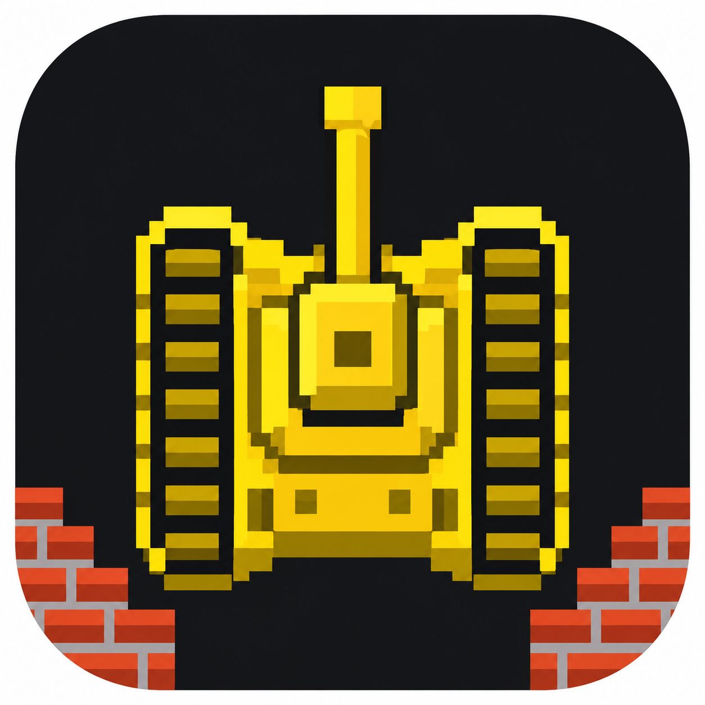
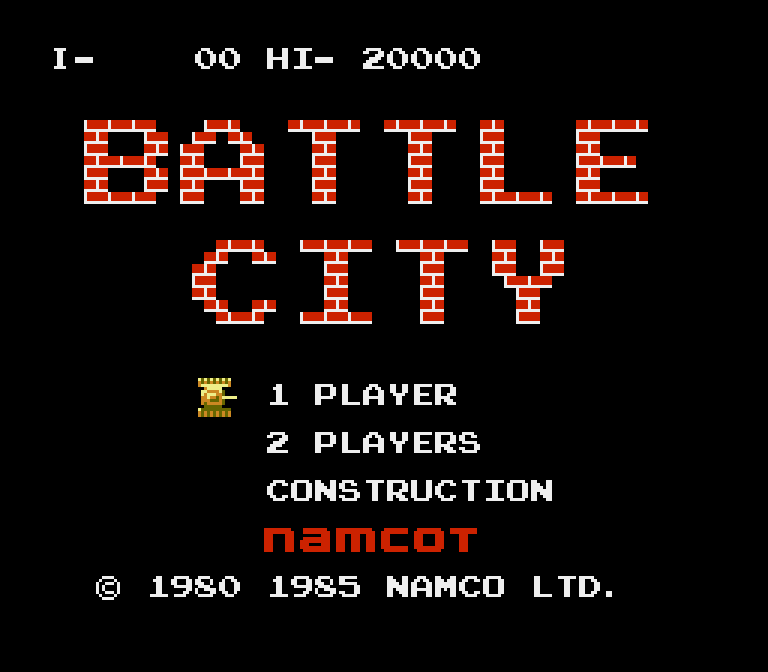
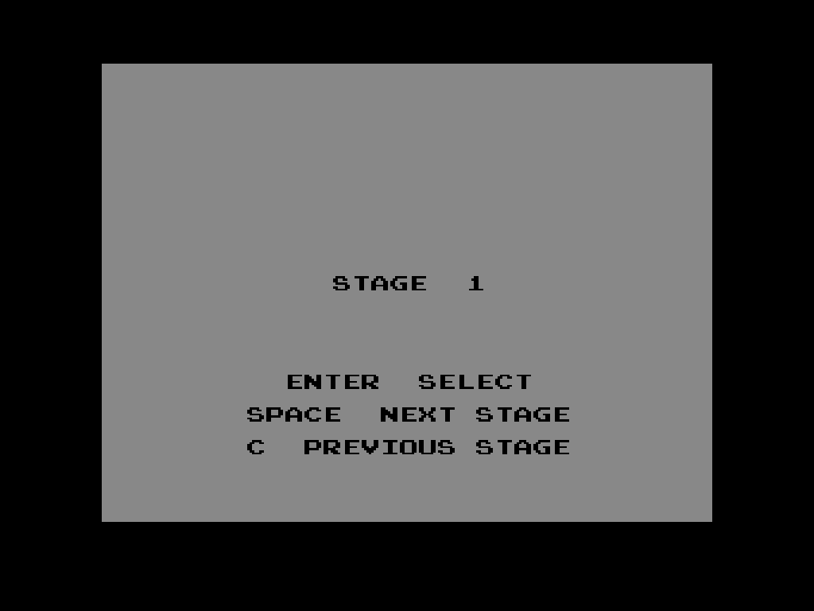
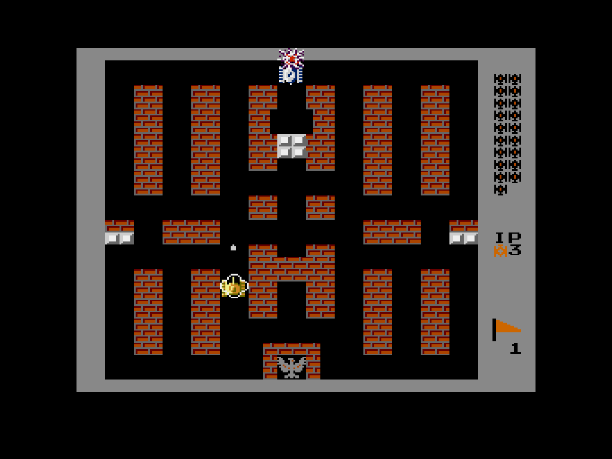
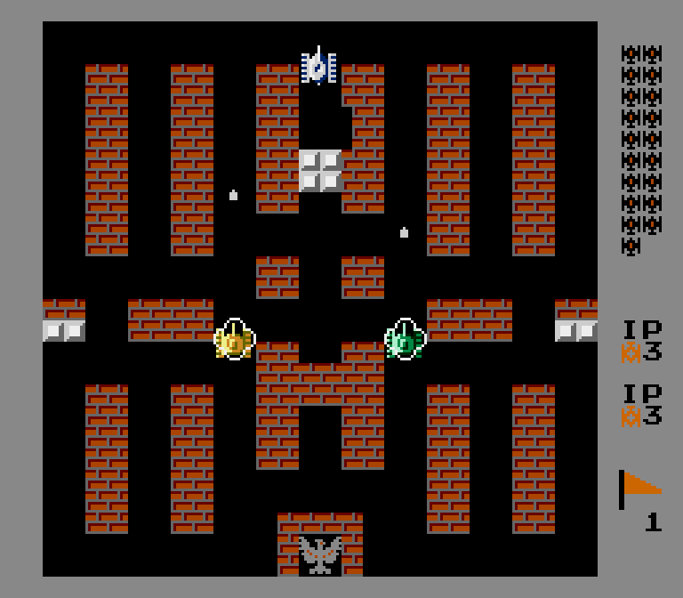

# Battle City

[Русская версия](README_RU.md)

Defend your base, destroy enemy tanks and fight through 35 classic stages.
Play solo or team up with a friend on the same computer. This standalone desktop
edition brings Battle City to Windows, Linux and macOS with its original pixel
graphics, level data and sound, keyboard controls and gamepad support.

## Screenshots

| Main menu | Stage selection |
|---|---|
|  |  |
| Single player | Local cooperative play |
|  |  |

## Features

- 35 stages, one-player and local two-player modes, and the original construction mode.
- Original game graphics and sound data, with nearest-neighbor scaling.
- Keyboard and standard gamepad controls for both players.
- English stage-selection hints drawn with the game's own bitmap font.
- Fullscreen mode, NTSC/PAL selection and a square-pixel display option.
- Save/load slots, automatic high-score saving and quick return to the main menu.
- Custom tank icon for the application window, Windows executable and macOS app.
- macOS builds for Intel (amd64) and Apple Silicon (arm64), with `.app` packaging.

## Play

Extract the release archive and launch:

- **Windows x64:** `bin/BattleCityMD-windows-amd64.exe`.
- **Linux x64:** `./bin/BattleCityMD-linux-amd64` in a graphical desktop session.
  Requires X11/XWayland, OpenGL and PulseAudio or ALSA runtime libraries.
- **macOS Intel:** `bin/BattleCityMD-macos-amd64.app`.
- **macOS Apple Silicon:** `bin/BattleCityMD-macos-arm64.app`.
  Open the matching app in Finder. The bundles target macOS 12 or newer and are
  not notarized by Apple.

Ready-to-run binaries do not require Go, an external emulator or an internet
connection. Press Enter to select a menu item. Choose **2 PLAYERS** for local co-op.

### Controls

| Action | Player 1 | Player 2 |
|---|---|---|
| Move | Arrow keys | W A S D |
| Fire / controller A, B, C | Z / X / C | G / H / J |
| Additional fire / B | Space | — |
| Start / in-game pause | Enter | Tab |

On the **STAGE** screen: **Enter** confirms, **Space** or **X** selects the next
stage, and **C** selects the previous stage.

Gamepads use the D-pad or left stick, the West/South/East face buttons and Start.

| Shortcut | Action |
|---|---|
| Esc | Quit from the main menu; return to the main menu from other screens |
| F1 | Show controls |
| F5 / F9 | Save / load state |
| F8 | Reset the console |
| F11 | Toggle fullscreen |
| M | Mute / unmute |
| F10 | Quit |

### Options

```sh
BattleCityMD-windows-amd64.exe -fullscreen
BattleCityMD-windows-amd64.exe -pal
BattleCityMD-windows-amd64.exe -aspect pixel -scale 4
```

Defaults: NTSC at 60 updates/s, a 4:3 display area and nearest-neighbor scaling.
`-pal` selects 50 updates/s, `-aspect pixel` uses integer scaling with square
pixels, `-scale 1..6` sets the initial window size, and `-mute` starts muted.

High scores and manual saves are stored under the user configuration directory
in `BattleCityMD-Go`: `%APPDATA%` on Windows and `$XDG_CONFIG_HOME` or
`~/.config` on Linux, and `~/Library/Application Support` on macOS.
Each region has one save-state slot. Version 0.1.1 saves
remain compatible with this release.

## Build from source

Requires **Go 1.25.7+**. Run commands from the project root, where `main.go` lives.
Dependencies are managed through Go modules; there is no vendored dependency tree.
Desktop builds use Ebitengine 2.10.5 with `CGO_ENABLED=0`; a C compiler, Xcode and
platform development headers are not required for compilation.

Windows PowerShell:

```powershell
go mod download
$env:CGO_ENABLED="0"
go build -trimpath -ldflags="-s -w -H=windowsgui" -o BattleCityMD.exe .
```

Linux:

```sh
go mod download
CGO_ENABLED=0 go build -trimpath -o BattleCityMD .
./BattleCityMD
```

macOS app bundles, from **Windows, Linux or macOS**:

```sh
go run build_macos.go
```

This builds both architectures into `bin/BattleCityMD-macos-amd64.app` and
`bin/BattleCityMD-macos-arm64.app`, including `Info.plist` and the ICNS icon.
To build just one architecture:

```sh
go run build_macos.go -arch amd64
go run build_macos.go -arch arm64
```

Run the helper with the Go toolchain for your current computer. It sets the
target environment for its child builds automatically. Local macOS builds are
ad-hoc signed when `codesign` is available; no Apple developer account is needed.

Plain macOS executables without app bundles (Bash/Zsh):

```sh
CGO_ENABLED=0 GOOS=darwin GOARCH=amd64 go build -trimpath -o bin/BattleCityMD-macos-amd64 .
CGO_ENABLED=0 GOOS=darwin GOARCH=arm64 go build -trimpath -o bin/BattleCityMD-macos-arm64 .
```

The included `icon_windows_amd64.syso` embeds the Windows application icon.
It is automatically excluded from macOS builds. Icon assets are `assets/icon.png`,
`assets/icon.ico` and `assets/icon.icns`.

## Implementation and license

The application uses a Go Mega Drive runtime to execute the bundled cartridge
program.

Application and adapted runtime: **GPL-3.0**, see [LICENSE](LICENSE).
Original game resources retain their original ownership. See
[THIRD_PARTY_NOTICES.md](THIRD_PARTY_NOTICES.md) for component attribution.

<!-- Icon asset: assets/icon.png; created with the built-in image generation tool.
Design brief: a golden top-down pixel-art tank, cannon facing up, on a dark
rounded app tile with red brick corners; no text, logos or watermark. -->
